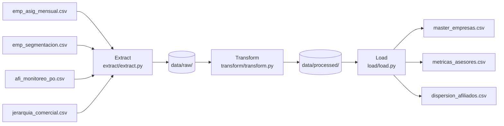

# Pipeline ETL — Detección de Dispersión en Pensión Obligatoria

> Pipeline que integra datos de asignación comercial, segmentación empresarial y monitoreo de aportes de una AFP para identificar afiliados con dispersión, calcular el potencial de recuperación por empresa y generar un ranking de desempeño por asesor.

**Curso:** ETL — Maestría en Inteligencia Artificial y Ciencia de Datos, Universidad Autónoma de Occidente  
**Periodo:** 2026-2  
**Docente:** Fernando Barraza Alvarado

---

## Integrantes

| jorge steven martinez angel 
| Andres Alexis Tafurt 
| Miguel Angel Marin


---

## Tabla de contenido

1. [Descripción del problema](#1-descripción-del-problema)
2. [Fuentes de datos](#2-fuentes-de-datos)
3. [Arquitectura del pipeline](#3-arquitectura-del-pipeline)
4. [Estructura del repositorio](#4-estructura-del-repositorio)
5. [Requisitos](#5-requisitos)
6. [Instalación y configuración](#6-instalación-y-configuración)
7. [Ejecución](#7-ejecución)
8. [Detalle de las etapas ETL](#8-detalle-de-las-etapas-etl)
9. [Modelo y diccionario de datos](#9-modelo-y-diccionario-de-datos)
10. [Calidad de datos y validaciones](#10-calidad-de-datos-y-validaciones)
11. [Resultados](#11-resultados)
12. [Limitaciones y trabajo futuro](#12-limitaciones-y-trabajo-futuro)
13. [Referencias](#13-referencias)

---

## 1. Descripción del problema

En Colombia, las Administradoras de Fondos de Pensiones (AFP) gestionan el ahorro pensional de los trabajadores a través de la Pensión Obligatoria (PO). Un fenómeno crítico en la operación comercial es la **dispersión**: afiliados que permanecen vinculados formalmente al fondo pero que han dejado de generar aportes, ya sea porque el empleador cambió de fondo, porque el trabajador quedó desempleado o por errores en la liquidación de nómina. La dispersión representa una pérdida directa de activos bajo administración y de ingresos por comisiones, y actualmente no existe visibilidad automatizada sobre qué empresas y asesores presentan este fenómeno.

**Objetivo:** Construir un pipeline ETL que integre cuatro fuentes de datos internas de la AFP para entregar tres productos analíticos: (1) un master de empresas con indicador de dispersión y score de potencial de recuperación; (2) un ranking objetivo de desempeño por asesor comercial; y (3) un listado priorizado de afiliados con dispersión activa. Estos datos son el insumo directo para la estrategia comercial B2B del equipo de asesores.

**Preguntas de investigación:**
1. ¿Cuáles afiliados presentan dispersión activa en pensión obligatoria?
2. ¿Qué empresas representan mayor oportunidad de recuperación para el equipo comercial?
3. ¿Qué asesores tienen oportunidad de mejora y cuáles merecen reconocimiento por su gestión?

---

## 2. Fuentes de datos

> **Aviso de privacidad:** Los datos utilizados provienen de una AFP real colombiana. Todos los identificadores de personas y empresas han sido anonimizados mediante hashing SHA-256 (campos `emp_hash64` y `afi_hash64`), cumpliendo con la **Ley 1581 de 2012 (Habeas Data)** y el **Decreto 1377 de 2013**. Los nombres de asesores fueron reemplazados por seudónimos (`nombre1`, `nombre2`…). El uso es exclusivamente académico bajo acuerdo de confidencialidad con la organización. En el repositorio se incluye únicamente una **muestra sintética de 15 filas** por fuente para permitir la ejecución del pipeline en entorno limpio.

| Fuente | Tipo | Origen | Tamaño real | Frecuencia | Licencia |
|---|---|---|---|---|---|
| `emp_asig_mensual.csv` | CSV interno | AFP (sistema de asignación comercial) | 103.467 filas × 5 cols | Mensual | Privada — uso académico con anonimización |
| `emp_segmentacion.csv` | CSV interno | AFP (segmentación B2B) | 10.000 filas × 2 cols | Corte único | Privada — uso académico con anonimización |
| `afi_monitoreo_po.csv` | CSV interno | AFP (monitoreo de aportes PO) | 10.000 filas × 5 cols | Bimestral | Privada — uso académico con anonimización |
| `jerarquia_comercial.csv` | CSV interno | AFP (estructura comercial) | 100 filas × 6 cols | Corte único | Privada — uso académico con anonimización |

---

## 3. Arquitectura del pipeline



El pipeline opera en modo **batch** sobre archivos CSV locales. La etapa de extracción valida la existencia y estructura de cada fuente antes de continuar. La transformación aplica 11 operaciones encadenadas (limpieza → integración → generación de variables → normalización) cuya llave de integración central es `emp_hash64`, presente en tres de las cuatro fuentes. La carga escribe los tres productos analíticos en `data/processed/` como CSV listos para consumo por dashboards o modelos de ML. Se eligió este destino local por simplicidad y porque los datos son de uso académico; en producción el destino natural sería un data warehouse (ej. PostgreSQL, BigQuery).

**Tecnologías:** Python 3.11, pandas 2.2.2, numpy 1.26.4

---

## 4. Estructura del repositorio

```
├── data/
│   ├── raw/                    ← Muestras sintéticas de 15 filas (CSV)
│   │   ├── emp_asig_mensual.csv
│   │   ├── emp_segmentacion.csv
│   │   ├── afi_monitoreo_po.csv
│   │   └── jerarquia_comercial.csv
│   └── processed/              ← Generado por el pipeline (no se sube a GitHub)
│       ├── master_empresas.csv
│       ├── metricas_asesores.csv
│       └── dispersion_afiliados.csv
│
├── extract/
│   └── extract.py              ← Lectura y validación de fuentes CSV
│
├── transform/
│   └── transform.py            ← 11 transformaciones (T1–T11)
│
├── load/
│   └── load.py                 ← Escritura de resultados en data/processed/
│
├── pipeline.py                 ← Orquestador: Extract → Transform → Load
├── requirements.txt            ← Dependencias con versiones fijas
├── .gitignore                  ← Excluye .venv/, data/processed/, .env
└── README.md                   ← Este archivo
```

---

## 5. Requisitos

- Python **3.11** o superior
- Las dependencias listadas en `requirements.txt` (pandas, numpy)
- No requiere base de datos ni servicios en la nube

---

## 6. Instalación y configuración

```bash
# 1. Clonar el repositorio
git clone https://github.com/jorgemartinez04-boceto/pension-etl.git
cd pension-etl

# 2. Crear y activar el entorno virtual
python -m venv .venv
source .venv/bin/activate        # Windows: .venv\Scripts\activate

# 3. Instalar dependencias
pip install -r requirements.txt
```

### Obtención de los datos

El repositorio incluye muestras sintéticas de 15 filas en `data/raw/` que permiten ejecutar y probar el pipeline completo. Para ejecutarlo sobre los datos reales:

1. Solicite los archivos CSV originales al responsable del proyecto.
2. Colóquelos en `data/raw/` con exactamente estos nombres:
   - `emp_asig_mensual.csv`
   - `emp_segmentacion.csv`
   - `afi_monitoreo_po.csv`
   - `jerarquia_comercial.csv`
3. Ejecute `python pipeline.py`.

> Los archivos reales **no se suben al repositorio** por restricciones de la Ley 1581 de 2012 y el acuerdo de confidencialidad con la AFP.

---

## 7. Ejecución

```bash
# Pipeline completo (Extract → Transform → Load)
python pipeline.py
```

**Salida esperada en consola:**

```
=======================================================
  PIPELINE ETL — PENSIÓN OBLIGATORIA AFP
=======================================================

[1/3] EXTRACCIÓN
  [OK] asignacion      —  103,467 filas  |  emp_asig_mensual.csv
  [OK] segmentacion    —   10,000 filas  |  emp_segmentacion.csv
  [OK] monitoreo       —   10,000 filas  |  afi_monitoreo_po.csv
  [OK] jerarquia       —      100 filas  |  jerarquia_comercial.csv

[2/3] TRANSFORMACIÓN
  T1  Duplicados eliminados: 89
  T2  Nulos en líder imputados como SIN_LIDER: 316
  ...

[3/3] CARGA
  [OK] master_empresas      → master_empresas.csv
  [OK] metricas_asesores    → metricas_asesores.csv
  [OK] dispersion           → dispersion_afiliados.csv

  Pipeline completado en ~2 segundos.
```

También se puede ejecutar cada etapa por separado:

```bash
python extract/extract.py
python transform/transform.py
python load/load.py
```

---

## 8. Detalle de las etapas ETL

### 8.1 Extract — `extract/extract.py`

- **Qué hace:** Lee los cuatro archivos CSV desde `data/raw/`. Valida existencia del archivo y presencia de columnas obligatorias antes de continuar. Falla con mensaje descriptivo si algún archivo falta o está malformado.
- **Salida:** Diccionario de DataFrames crudos en memoria (`asignacion`, `segmentacion`, `monitoreo`, `jerarquia`).

### 8.2 Transform — `transform/transform.py`

- **Qué hace:** Aplica 11 transformaciones encadenadas organizadas en cuatro grupos.
- **Salida:** Tres DataFrames transformados (`master_empresas`, `metricas_asesores`, `dispersion`).

| # | Transformación | Justificación |
|---|---|---|
| T1 | Deduplicación por `(emp_hash64, periodo_asignacion, id_posicion_ejecutivo)` | 89 duplicados exactos detectados en EDA — inflan conteo por asesor |
| T2 | Nulos en `id_posicion_lider_equipo` → `'SIN_LIDER'` | 316 nulos — necesario para análisis de estructura jerárquica |
| T3 | Winsorización de `salario_tope` al P99 | 100 outliers sesgan la masa salarial agregada por empresa |
| T4 | Exclusión del periodo `202606` del análisis de dispersión | Periodo sin contraparte en monitoreo — comparación asimétrica |
| T5 | Ejecutivos sin perfil en jerarquía → `'EJECUTIVO_HISTORICO'` | 382 ejecutivos históricos no evaluables por ausencia de perfil |
| T6 | LEFT JOIN: asignación vigente + segmentación + monitoreo sobre `emp_hash64` | Llave común a tres fuentes — construye tabla maestra |
| T7 | `flag_dispersion` = 1 si empresa activa en P1 desaparece en P2 | Responde directamente a la Pregunta 1 de investigación |
| T8 | `score_potencial` = segmento (40%) + masa salarial (35%) + afiliados (25%) | Normalización min-max — prioriza gestión comercial (Pregunta 2) |
| T9 | Métricas por asesor: retención, cobertura, score promedio, ranking | Ranking objetivo de desempeño (Pregunta 3) |
| T10 | Periodo `YYYYMM` → `fecha` (`YYYY-MM-01`) | Permite cálculos de diferencia temporal entre fuentes |
| T11 | Conserva última asignación por empresa (103.467 → 34.924 filas) | Elimina historial para obtener asignación vigente |

### 8.3 Load — `load/load.py`

- **Qué hace:** Guarda los tres DataFrames procesados en `data/processed/` como CSV con codificación `utf-8-sig` (compatible con Excel). Agrega columna `fecha_carga` con marca de tiempo.
- **Destino:** `data/processed/master_empresas.csv`, `metricas_asesores.csv`, `dispersion_afiliados.csv`.
- **Modo:** Reemplazo completo en cada ejecución (no incremental).

---

## 9. Modelo y diccionario de datos

### `master_empresas.csv` — Tabla principal de empresas

| Columna | Tipo | Descripción | Ejemplo |
|---|---|---|---|
| `emp_hash64` | string | Identificador anonimizado de la empresa (SHA-256) | `622a53c3...` |
| `periodo_asignacion` | int | Último periodo de asignación (YYYYMM) | `202508` |
| `id_posicion_lider_equipo` | string | Código del líder de equipo del asesor | `CO_12845` |
| `id_posicion_ejecutivo` | string | Código del asesor asignado | `CO_12863` |
| `id_tipo_ejecutivo` | string | Tipo de ejecutivo o `EJECUTIVO_HISTORICO` | `PRO_ASE_APR` |
| `desc_segmento_empleador_actual` | string | Segmento empresarial: `PREMIUM` o `BASIC` | `PREMIUM` |
| `num_afiliados` | float | Número de afiliados PO activos registrados | `12` |
| `masa_salarial_win` | float | Masa salarial total (winsorizad al P99) en COP | `45000000` |
| `flag_dispersion` | int | 1 si la empresa perdió afiliados entre periodos | `1` |
| `afiliados_perdidos` | float | Cantidad de afiliados que dejaron de cotizar | `5` |
| `score_potencial` | float | Índice de potencial comercial [0–1] | `0.7234` |
| `fecha_carga` | datetime | Marca de tiempo de la ejecución del pipeline | `2026-01-15 10:30:00` |

### `metricas_asesores.csv` — Ranking de desempeño por asesor

| Columna | Tipo | Descripción | Ejemplo |
|---|---|---|---|
| `id_posicion_ejecutivo` | string | Código del asesor | `CO_12863` |
| `nombreEjecutivo` | string | Seudónimo del asesor | `nombre57` |
| `descRegional` | string | Zona comercial | `EQUIPO COMERCIAL ZONA BOGOTA Y CENTRO` |
| `n_empresas` | int | Total de empresas asignadas | `72` |
| `n_premium` | int | Empresas PREMIUM en cartera | `28` |
| `tasa_retencion` | float | Proporción de empresas sin dispersión [0–1] | `0.85` |
| `ranking_final` | int | Posición en el ranking de desempeño (1 = mejor) | `3` |
| `fecha_carga` | datetime | Marca de tiempo de la ejecución | `2026-01-15 10:30:00` |

### `dispersion_afiliados.csv` — Empresas con dispersión detectada

| Columna | Tipo | Descripción | Ejemplo |
|---|---|---|---|
| `emp_hash64` | string | Identificador anonimizado de la empresa | `0b37d066...` |
| `flag_dispersion` | int | 1 = dispersión activa | `1` |
| `afiliados_p1` | float | Afiliados en el primer periodo | `8` |
| `afiliados_p2` | float | Afiliados en el segundo periodo | `0` |
| `afiliados_perdidos` | float | Diferencia P1 − P2 | `8` |

---

## 10. Calidad de datos y validaciones

| Verificación | Antes (datos reales) | Después |
|---|---|---|
| Filas en `emp_asig_mensual` | 103.467 | 103.378 (-89 duplicados) |
| Registros duplicados exactos | 89 | 0 |
| Nulos en `id_posicion_lider_equipo` | 316 | 0 (imputados como `SIN_LIDER`) |
| Salarios > P99 ($19,2M) | 100 | 0 (winsorizados) |
| Periodo `202606` en análisis dispersión | presente | excluido |
| Ejecutivos sin perfil en jerarquía | 382 | marcados como `EJECUTIVO_HISTORICO` |
| Empresas sin segmento conocido | ~23.894 | `NaN` (no imputado — se refleja en score) |

---

## 11. Resultados

Con los datos reales de la AFP el pipeline genera:

```
master_empresas.csv     →  34.924 empresas con score de potencial y flag de dispersión
metricas_asesores.csv   →  66 asesores activos con ranking de desempeño
dispersion_afiliados.csv→  2.110 empresas con dispersión detectada (89,4% de las activas en P1)
```

**Consultas de ejemplo sobre los resultados:**

```python
import pandas as pd

# Top 10 empresas por score de potencial sin asesor asignado
master = pd.read_csv("data/processed/master_empresas.csv")
sin_asesor = master[master["id_posicion_ejecutivo"].isna()]
print(sin_asesor.nlargest(10, "score_potencial")[["emp_hash64","desc_segmento_empleador_actual","score_potencial"]])

# Ranking de asesores por tasa de retención
asesores = pd.read_csv("data/processed/metricas_asesores.csv")
print(asesores.sort_values("ranking_final")[["nombreEjecutivo","n_empresas","tasa_retencion","ranking_final"]].head(10))

# Empresas con mayor dispersión
disp = pd.read_csv("data/processed/dispersion_afiliados.csv")
print(disp[disp["flag_dispersion"]==1].nlargest(10,"afiliados_perdidos"))
```

---

## 12. Limitaciones y trabajo futuro

- **Cobertura de monitoreo:** Solo el 8,3% de las empresas asignadas tienen datos de aportes PO en el periodo analizado. El score de potencial es menos preciso para empresas sin actividad registrada.
- **Dos periodos de monitoreo:** Con solo dos cortes (abr-25 y ago-25) no es posible distinguir dispersión real de variación estacional. Se requieren al menos 6 meses continuos.
- **Carga no incremental:** El pipeline reemplaza los archivos de salida en cada ejecución. En producción se implementaría carga incremental con detección de cambios (`upsert`).
- **Sin automatización:** El pipeline se ejecuta manualmente. Como trabajo futuro se propone programarlo con Apache Airflow o un cron job mensual.
- **Destino local:** Los CSV de salida son apropiados para el entorno académico. En producción el destino sería un data warehouse (PostgreSQL, BigQuery) para consumo por herramientas de BI.

---

## 13. Referencias

- Congreso de Colombia. (2012). *Ley 1581 de 2012 — Protección de datos personales*. [https://www.funcionpublica.gov.co/eva/gestornormativo/norma.php?i=49981](https://www.funcionpublica.gov.co/eva/gestornormativo/norma.php?i=49981)
- Presidencia de la República de Colombia. (2013). *Decreto 1377 de 2013 — Reglamentación Ley 1581*. [https://www.alcaldiabogota.gov.co/sisjur/normas/Norma1.jsp?i=53646](https://www.alcaldiabogota.gov.co/sisjur/normas/Norma1.jsp?i=53646)
- McKinney, W. (2022). *Python for Data Analysis* (3rd ed.). O'Reilly Media.
- Pandas Development Team. (2024). *pandas 2.2 documentation*. [https://pandas.pydata.org/docs/](https://pandas.pydata.org/docs/)
- Uso de IA generativa: Claude (Anthropic) fue utilizado como asistente para estructura del código, revisión de la lógica de transformaciones. Los datos, el análisis, las decisiones de diseño del pipeline y la 
validación de resultados fueron realizados por el autor del proyecto.
